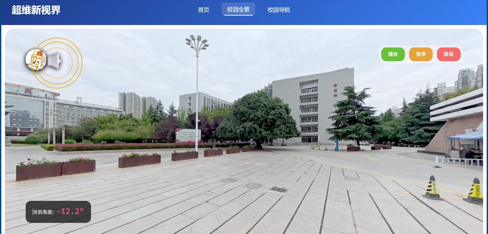
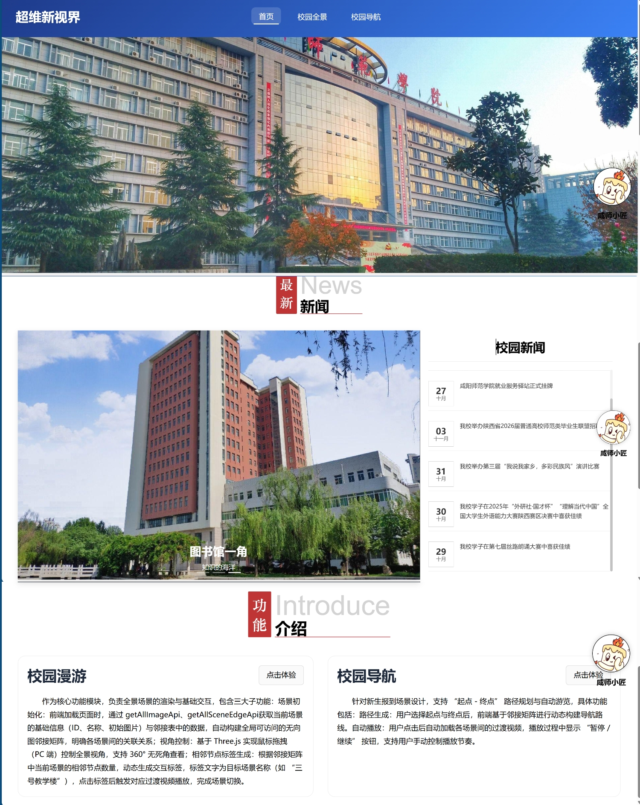
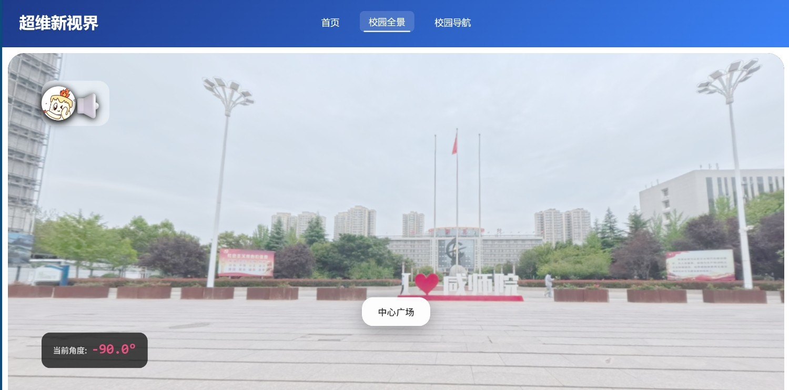
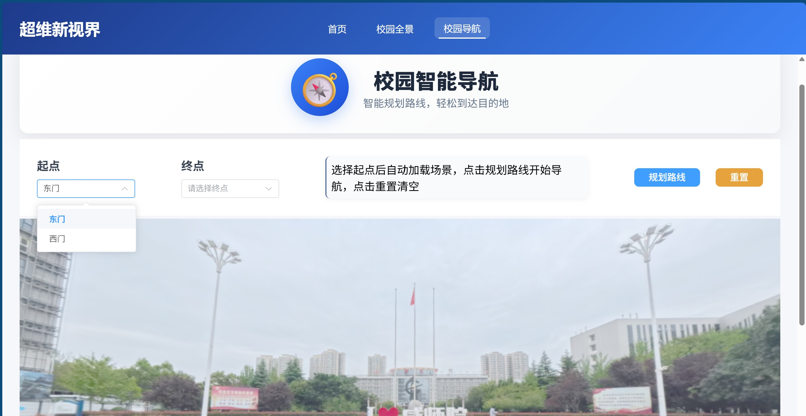
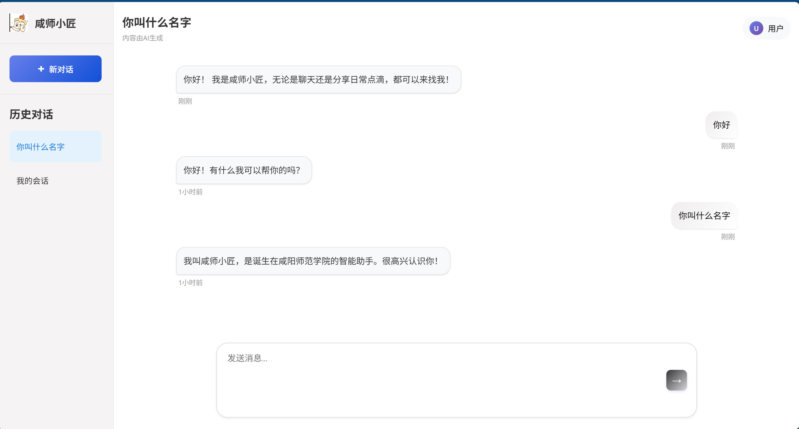
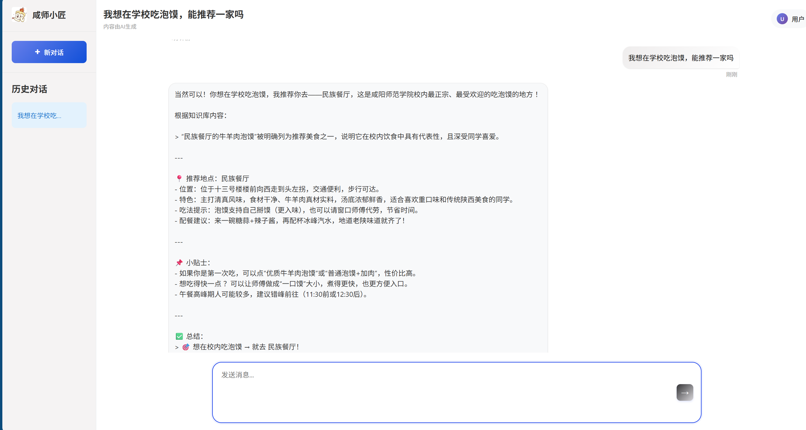
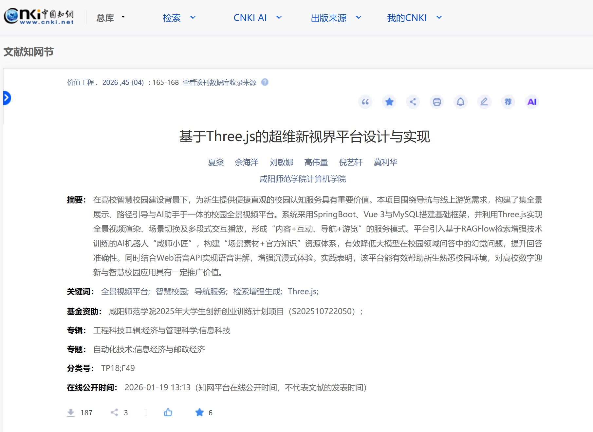
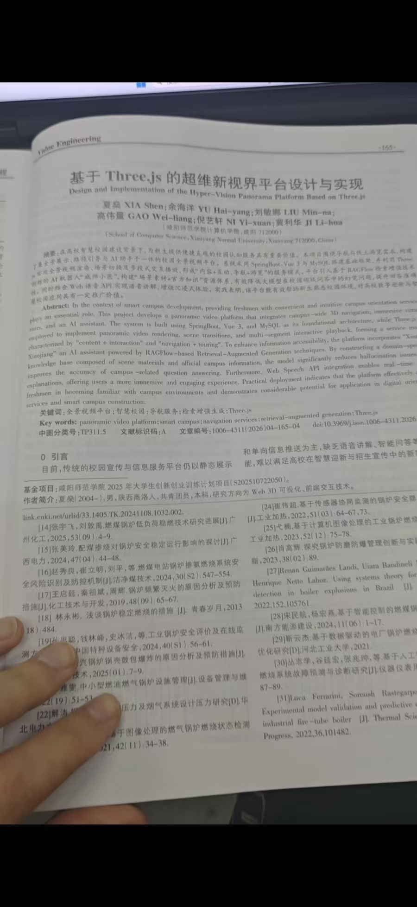
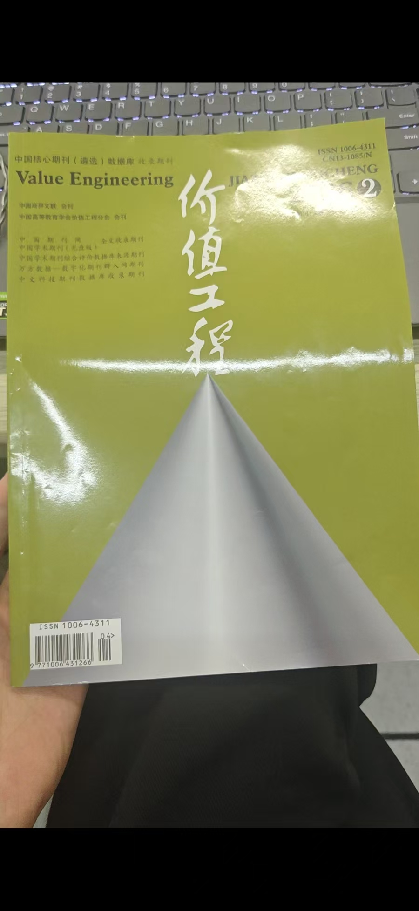
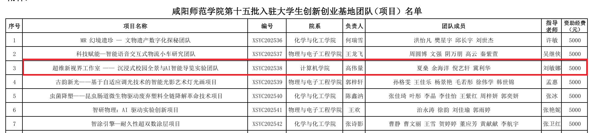

# 超维新视界 · 沉浸式校园全景与 AI 智能导览平台

<p align="center">
  
</p>

**把整座校园装进浏览器。** 打开网页，拖动鼠标就能 360° 环视东门广场；点一下画面里的「中心广场」，一段实拍的行进镜头带你走过去；走神了也没关系，页面会用语音把眼前这栋楼讲给你听。想直接去某个地方，就在导航里选起点和终点，系统沿着场景图把路线一段段播给你。旁边还有一个叫「咸师小匠」的 AI 助手，问它「图书馆几点开门」「机电学院在哪」都能答上来。

这是我在咸阳师范学院读本科期间主导的省级大学生创新创业训练计划项目。整套系统从校园实拍、场景建模、前端 3D 渲染到后端服务全部由团队自己完成，2026 年 4 月以第一作者身份在《价值工程》发表论文。

> **省级立项** S202510722050 · **2025.09** 立项 · **2026.04** 论文见刊 · **15 个月** 从申报到发表

`Java 17` · `Spring Boot 3.5` · `Vue 3` · `Three.js` · `MySQL 8` · `RAGFlow`

---

## 目录

**了解项目**　[项目概况](#项目概况) · [演示视频](#演示视频) · [界面截图](#界面截图) · [要解决的问题](#要解决的问题) · [项目历程](#项目历程) · [成果与荣誉](#成果与荣誉)

**看实现**　[技术栈](#技术栈) · [系统架构](#系统架构) · [核心实现](#核心实现) · [数据库设计](#数据库设计) · [目录结构](#目录结构)

**动手跑**　[本地运行](#本地运行) · [已知限制](#已知限制) · [简历版描述](#简历版描述) · [团队与分工](#团队与分工) · [致谢](#致谢)

---

## 项目概况

| 项目 | 内容 |
| --- | --- |
| 项目名称 | 超维新视界 —— 沉浸式校园全景与 AI 智能导览实验团队 |
| 项目类型 | 大学生创新训练项目（创业实践方向） |
| 立项级别 | 省级 |
| 项目编号 | S202510722050 |
| 依托单位 | 咸阳师范学院 计算机学院 |
| 指导教师 | 刘敏娜 |
| 项目负责人 | 高伟量 |
| 团队成员 | 夏燊、余海洋、倪艺轩、冀利华、蔚荣康 |
| 建设周期 | 2025 年 9 月立项，2026 年 3 月完成交付，2026 年 4 月论文见刊 |
| 交付形态 | Web 平台（前后端分离）+ 校园全景素材库 + 校园知识库 |

项目同时入选咸阳师范学院第十五批校园创业孵化基地（计算机学院当批唯一入选的团队），获 5000 元资助基金。

## 演示视频

https://github.com/user-attachments/assets/43d3e53e-0c05-47d7-b4ad-15d66712589a

时长 1 分 43 秒，配音讲解，按「首页 → 全景漫游 → 场景跳转 → 校园导航 → AI 助手」的顺序完整走了一遍真实操作流程。
想看清细节的话，可以下载 [1080p 版本](https://github.com/xs2580/hyper-vision-campus/releases/download/v1.0.0/hyper-vision-demo-1080p.mp4)。

> 视频里的校园是真实拍摄的：用影石 360 全景相机在校园里走了整整两天，拍了东门、东门广场、中心广场、图书馆、教学楼、食堂等场景，再逐段剪辑成「场景图 + 过渡镜头」。

## 界面截图

**首页**　轮播、校园新闻、功能入口。右侧那只会飘的小狮子，就是 AI 助手「咸师小匠」的入口。

<p align="center">
  
</p>

**全景漫游**　球面投影的全景画面，中央浮着相邻场景的标签，左下角实时显示当前视角角度。点标签即触发场景跳转。

<p align="center">
  
</p>

**校园导航**　选起点和终点，系统沿场景图规划，把路线逐段播成行进视频。

<p align="center">
  
</p>

**AI 助手「咸师小匠」**　多会话、流式输出、Markdown 渲染。回答走校园知识库检索，会给出依据而不是凭空生成。

<p align="center">
  
  
</p>

## 要解决的问题

新生报到前对校园几乎没有空间概念。学校官网给的是平面图和几张照片，看完了还是不知道「从东门走到宿舍要经过什么」「三号教学楼在哪个方向」。市面上的地图 App 能告诉你路线，但给不了「站在这里抬头看到什么」的直观感受。

这个项目想做的事很具体：

1. **让人先「看见」再「走过去」**。全景图负责「看见」，实拍的行进视频负责「走过去」，两者拼起来就是一次完整的空间认知。
2. **把路线变成可以播放的东西**。传统导航给的是一条线，这里给的是一段第一人称视角的行走视频。
3. **把「问路」变成「问人」**。校园信息分散在官网、公众号、贴吧里，用一个带校园知识库的 AI 助手统一回答，比翻网页快得多。

和常见的 VR 校园项目相比，这里没有做三维建模重建，而是用真实拍摄的全景影像做「1:1 还原」——成本低一个数量级，真实度高一个数量级，代价是视角只能停留在拍摄点位，不能自由飞行。这是一个明确的取舍。

## 技术栈

| 层次 | 技术 | 用途 |
| --- | --- | --- |
| 前端框架 | Vue 3（`<script setup>` 组合式 API） | 单页应用，四个路由页面 |
| 路由 | Vue Router 4 | 首页 / 全景 / 导航 / AI 助手 |
| 3D 渲染 | Three.js 0.180 | 球面投影、视频纹理、相机控制 |
| UI 组件 | Element Plus、TDesign Vue Next | 轮播、下拉、按钮、聊天界面 |
| 请求 | Axios + fetch | 普通接口用 Axios，SSE 流式用 fetch |
| 构建 | Vite 3 | 开发代理、生产打包 |
| 后端框架 | Spring Boot 3.5 / JDK 17 | RESTful 接口、静态资源流式输出 |
| 持久层 | MyBatis 3（注解 SQL） | 场景、视频、边三张表 |
| 数据库 | MySQL 8.0 | 场景元数据与导航图 |
| 智能问答 | RAGFlow + Embedding | 校园知识库检索增强生成 |
| 语音 | Web Speech API（SpeechSynthesis） | 场景语音讲解 |
| 全景采集 | 影石 360 全景相机 | 8K 全景照片与视频素材 |

选型上有一个原则：**能在浏览器里做的，就不放服务器**。全景渲染、语音合成、路径查询全部在前端完成，后端只负责「把文件流出去」和「把表查出来」，所以一台 2 核 4G 的云服务器就能撑住整个平台。

## 系统架构

```
┌──────────────────────────────────────────────────────────────┐
│                         浏览器（用户侧）                        │
│                                                              │
│   首页 / 全景漫游 / 校园导航 / AI 助手  ← Vue Router           │
│        │            │            │           │               │
│        │     Three.js 渲染层      │           │               │
│        │  ┌──────────────────┐    │           │               │
│        │  │ 球面几何 + 纹理    │    │           │               │
│        │  │ VideoTexture     │    │           │               │
│        │  │ OrbitControls    │    │           │               │
│        │  └──────────────────┘    │           │               │
│        │       Web Speech API     │      fetch + SSE 流解析     │
└────────┼────────────┼─────────────┼───────────┼───────────────┘
         │  Axios     │             │           │
         ▼            ▼             ▼           ▼
┌──────────────────────────────────────────────────────────────┐
│                    Spring Boot 3.5（:8080）                   │
│                                                              │
│   /image        /video        /edge         /api/chat/**      │
│   场景列表      视频流        导航图        RAGFlow 代理        │
│   图片流式输出  视频流式输出   边表查询      SSE 透传            │
│      │            │             │              │              │
│   ImageService  VideoService  SceneEdgeService  WebClient      │
│      │            │             │              │              │
│   ImageMapper  VideoMapper  SceneEdgeMapper     │              │
└──────┼────────────┼─────────────┼──────────────┼──────────────┘
       ▼            ▼             ▼              ▼
   ┌────────────────────────┐          ┌──────────────────┐
   │  MySQL 8.0             │          │  RAGFlow 服务     │
   │  image / video /       │          │  向量库 + 大模型   │
   │  scene_edge            │          │  校园知识库        │
   └────────────────────────┘          └──────────────────┘
       ▲
       │ 只存路径
   ┌────────────────────────┐
   │  磁盘 / 对象存储         │
   │  全景图 *.jpg           │
   │  过渡视频 *.mp4          │
   └────────────────────────┘
```

一次完整的场景跳转是这样跑的：

```
用户点击标签
   → 前端从邻接表取出 (targetSceneId, videoId)
   → GET /video/{videoId} 拿到视频流
   → <video> 触发 canplay
   → 创建 THREE.VideoTexture，替换球体材质贴图
   → 视频播放完毕，GET /image/{targetSceneId} 换成目标场景全景图
   → 重建该场景的热点标签，更新地图位置
```

## 核心实现

### 1. 全景球：把一张等距圆柱投影图变成「天空」

全景图的本质是一张 2:1 的等距圆柱投影（equirectangular）。要做成沉浸式视角，得把它贴在一个球的内壁上，相机站在球心。Three.js 里最省事的做法是把球面几何沿 X 轴翻转，让法线朝内：

```js
// web/src/views/layout/VR_Map.vue
const geometry = new THREE.SphereGeometry(500, 60, 40)
geometry.scale(-1, 1, 1)                 // 关键：翻转法线，从球内看贴图

material = new THREE.MeshBasicMaterial({ color: 0xffffff })
sphere = new THREE.Mesh(geometry, material)
scene.add(sphere)

camera = new THREE.PerspectiveCamera(75, w / h, 0.1, 1000)
camera.position.set(1, -0.1, 0)          // 站在球心附近，留一点偏移避免奇异点

controls = new OrbitControls(camera, renderer.domElement)
controls.enableDamping = true            // 拖拽惯性，转起来更顺
```

这里有两个容易踩的坑：

- **不翻转法线**：贴图会贴在球的外表面，相机在球内只能看到纯黑。
- **`MeshBasicMaterial` 不能换成 `MeshStandardMaterial`**：全景图本身已经带了光照信息，再加光照会过曝，而且性能白白浪费。

材质用的是 `MeshBasicMaterial`，贴图通过 `TextureLoader` 异步加载，加载完成后再 `material.needsUpdate = true`，避免出现一帧黑屏。

### 2. 视角与标签：怎么知道用户「正在看哪」

全景里没有真正的三维物体，所有交互标签都得靠计算相机朝向，判断「这个方向有没有路」。每帧从相机取世界方向向量，换算成水平角和俯仰角：

```js
const dir = new THREE.Vector3()
camera.getWorldDirection(dir)

const yaw   = Math.atan2(dir.x, -dir.z) * (180 / Math.PI)  // 水平角，-180~180
const pitch = Math.asin(dir.y) * (180 / Math.PI)           // 俯仰角，-90~90
```

数据库 `scene_edge.angle` 里存的是「这条路在画面中的方位角」，前端拿到后和当前 yaw 做差：

```js
let diff = Math.abs(yaw - edge.angle)
if (diff > 180) diff = 360 - diff      // 处理 ±180 边界
hotspot.visible = diff <= 25           // 进入 ±25° 视野才显示
```

±25° 这个阈值是调出来的：太小，用户得来回找；太大，几个标签会挤在一起。标签本身用一个半透明毛玻璃方块，配合向下指的箭头。箭头还做了个小细节——根据 pitch 用 CSS 3D 变换做一个「透视仰角」，用户抬头时箭头立起来，低头时趴下去，视觉上更像贴在地面上的路标：

```html
<div class="tag-notice"
     :style="{
       opacity: cameraPitch < 30 ? Math.max(0, (30 - cameraPitch) / 30) : 0,
       transform: `perspective(80px) rotateX(${-cameraPitch}deg)`
     }">
```

### 3. 场景图：用「边」描述校园

整个校园在数据层面就是一张有向图。节点是场景（`image` 表），边是「从 A 走到 B 会经过什么」（`scene_edge` 表），边上挂一条过渡视频和标签方位角。

前端一次性拉全量边表，在内存里建成邻接表：

```js
// 建表：Map<startId, Edge[]>
for (const edge of edgeList.value) {
  if (!neighbourList.has(edge.startId)) neighbourList.set(edge.startId, [])
  const endScene = allScenes.value.find(s => s.id == edge.endId)
  if (endScene) {
    neighbourList.get(edge.startId).push({
      sceneId: edge.endId,
      videoId: edge.videoId,
      description: endScene.description,
      angle: edge.angle
    })
  }
}
```

这张表同时支撑了三件事：当前场景有哪些出口（生成标签）、导航页的终点候选（只列出相邻场景）、点标签后该播哪段视频。

论文里把这个结构写作「邻接矩阵」，代码里实际用的是邻接表——场景是稀疏图，一个点位通常只有 2~4 个出口，邻接表在查找邻居时是 O(1)，比矩阵更合适。这里以代码为准。

### 4. 视频过渡：把「走路」这件事渲染进全景

从东门到中心广场，不是简单换一张图，而是播一段第一人称行走的全景视频。做法是把 `<video>` 当作纹理源，实时贴到球面上：

```js
vid = document.createElement('video')
vid.crossOrigin = 'anonymous'
vid.playsInline = true

vid.addEventListener('canplay', () => {
  videoTexture = new THREE.VideoTexture(vid)
  videoTexture.minFilter = THREE.LinearFilter
  videoTexture.magFilter = THREE.LinearFilter
  material.map = videoTexture
  material.needsUpdate = true
  vid.play()
}, { once: true })

vid.onended = async () => {
  await loadBackgroundImage(targetSceneId)   // 换成目标场景的静态全景
  buildHotspots()                            // 重建出口标签
}
```

几个不那么直观的处理：

- **`{ once: true }`**：`canplay` 在拖动进度条时会重复触发，不加一次性监听会重复创建 `VideoTexture`，显存直接爆掉。
- **播放期间隐藏标签**：用 `allowShowTag` 开关控制，避免用户一边看行进镜头一边误点。
- **播放/暂停做 1.7 秒防抖**：视频解码需要时间，连续点击会让 `play()` 和 `pause()` 打架，按钮先禁用 1.7 秒，等状态稳定再放开。
- **资源释放**：换场景时 `videoTexture.dispose()`、`vid.src = ''`、`vid.load()` 三件套必须做全，否则每跳一次场景就泄漏一个解码器，逛十分钟浏览器就卡死。

### 5. 语音讲解：让页面「开口说话」

浏览器自带的 `SpeechSynthesis` 就够用，没必要上云端 TTS。实现上做了几件细活：

```js
const utter = new SpeechSynthesisUtterance(text)
const yunxia = voices.find(v => v.name.includes('Microsoft Yunxia Online (Natural)'))
if (yunxia) utter.voice = yunxia          // 优先选自然度最高的中文女声
utter.lang = 'zh-CN'
utter.rate = 1.0
window.speechSynthesis.speak(utter)
```

难点不在「读」，在「和视频同步」：

- 视频暂停 → `speechSynthesis.pause()`，视频继续 → `resume()`；
- 用户点「静音」→ 直接 `cancel()`，并且把 `isSpeaking` 复位，声波动画停下来；
- 语音自然播放结束 → 关掉声波动画，且不再允许播放/暂停按钮反向控制它（`isControl = false`）。

界面上那个会呼吸的声波，就是 `isSpeaking` 驱动的三个 CSS 圆环动画，成本几乎为零。

### 6. 校园导航：选两个点，剩下的交给图

导航页把「路径规划」做得很克制：起点固定为东门 / 西门（校外进入校园的两个入口），终点从当前起点的邻居里动态生成。选中后按邻接表的边逐段播放过渡视频。

页面还维护一张校园地图缩略图，用百分比坐标标出当前位置。有意思的是位置点的切换时机——不是等视频播完才移动，而是在 `timeupdate` 里判断播放进度超过 50% 就把点挪到下一个场景，视觉上更接近「走到一半了」：

```js
vid.addEventListener('timeupdate', () => {
  const progress = (vid.currentTime / vid.duration) * 100
  if (progress >= 50) updateHalfMapPosition(currentSceneId)
})
```

「重置路线」不是简单清空下拉框，而是把 `videoTexture` 释放、球体材质恢复成白色、起点终点状态归零，保证下一次规划从干净状态开始。

### 7. AI 助手「咸师小匠」：给大模型一本校园手册

通用大模型答「咸阳师范学院图书馆几点关门」这种问题，十有八九是编的。解决办法是检索增强生成：先把校园资料整理成知识库，提问时先检索、再让模型基于检索结果回答。

知识库的来源包括校内建筑与地标说明、各二级学院介绍、部门职能、校史校情、食堂与生活服务信息，以及团队自己写的场景讲解词。RAGFlow 负责切分、向量化和检索，前端只管把问题发过去、把流式回答渲染出来。

后端用 WebClient 调 RAGFlow 的 `/api/v1/chats/{chatId}/completions`，以 SSE 形式透传给前端：

```java
@PostMapping(value = "/{chatId}/stream", produces = MediaType.TEXT_EVENT_STREAM_VALUE)
public Flux<String> chatStream(@PathVariable String chatId, @RequestBody ChatRequest request) {
    return ragFlowService.chatCompletionStream(chatId, request)
            .onErrorResume(e -> Flux.just("data: " + e.getMessage()));
}
```

前端不用 `EventSource`（它只支持 GET），改用 `fetch` + `ReadableStream` 手动解帧，每读到一个 `data:` 片段就更新消息内容，并用 `requestAnimationFrame` 节流渲染，避免高频 `setState` 把页面卡住：

```js
const reader = response.body.getReader()
const decoder = new TextDecoder()
// 逐块读取 → 按 \n\n 切分事件 → JSON.parse → 累加到 aiResponse
```

会话管理（新建、列表、删除）也一并做了，存在 RAGFlow 侧，刷新页面能接着上次聊。

> **关于代码现状**：`Chatcontorller.java`、`RagFlowService.java`、`RagFlowProperties.java` 三个文件在当前仓库中处于整体注释状态。原因是项目结题后 RAGFlow 实例与 API Key 已回收，保留可运行代码会因鉴权失败不断报错。完整实现（182 行，含流式转发、会话增删、错误兜底）原样保留在注释里，接入自己的 RAGFlow 实例后取消注释、填入 Key 即可恢复。前端 AI 页面、接口封装、流式解析逻辑均为可用状态。

### 8. 后端：只做三件事

后端刻意做得很薄，只有三类接口：

| 接口 | 说明 |
| --- | --- |
| `GET /image` | 返回全部场景元数据（id、描述、路径） |
| `GET /image/{id}` | 返回全景图字节流 |
| `GET /video` | 返回全部过渡视频元数据 |
| `GET /video/{id}` | 返回视频字节流 |
| `GET /edge` | 返回全部场景边，前端据此建邻接表 |

文件输出没有走 `static` 目录，而是用 `FileSystemResource` 流式返回，手动设置 `Content-Type` 与 `Content-Length`：

```java
Resource resource = new FileSystemResource(file);
HttpHeaders headers = new HttpHeaders();
headers.setContentType(MediaType.parseMediaType("video/mp4"));
headers.setContentLength(file.length());
return new ResponseEntity<>(resource, headers, HttpStatus.OK);
```

这样素材可以放在任意磁盘路径（甚至后续换成对象存储），不用跟着 jar 包走，也不会一次性把几十兆的视频读进内存。

所有 JSON 接口统一返回 `Result{ code, msg, data }`，`code = 1` 表示成功。前端 `request.js` 里统一拦截，遇到 401 跳登录、404 打印请求地址，省得每个页面各写一套错误处理。

## 数据库设计

三张表，结构非常简单，因为复杂度都在前端的图算法里。

```
   image (场景)                 scene_edge (边)                video (过渡视频)
┌──────────────┐          ┌────────────────────┐          ┌──────────────┐
│ id      PK   │◄─────────│ start_id      FK   │          │ id      PK   │
│ url          │          │ end_id        FK   │─────────►│ url          │
│ description  │◄─────────│ video_id      FK   │          │ create_time  │
│ create_time  │          │ angle              │          │ update_time  │
│ update_time  │          │ create_time        │          └──────────────┘
└──────────────┘          │ update_time        │
                          └────────────────────┘
```

| 表 | 关键字段 | 说明 |
| --- | --- | --- |
| `image` | `url`、`description` | 一个场景一个节点；`description` 会直接显示在标签与地图上 |
| `video` | `url` | 一段过渡镜头，被多条边复用 |
| `scene_edge` | `start_id`、`end_id`、`video_id`、`angle` | 有向边；`angle` 决定标签出现在画面哪个方位 |

建表与演示数据在 [`database/schema.sql`](database/schema.sql) 和 [`database/seed-demo.sql`](database/seed-demo.sql)。`image_reverse` / `video_reverse` 是给「原路返回」预留的反向表，本版本未接接口。

## 目录结构

```
hyper-vision-campus/
├── server/                          Spring Boot 后端
│   ├── pom.xml
│   └── src/main/
│       ├── java/com/webproject/
│       │   ├── controller/          ImageResController / VideoResController / SceneEdgeController
│       │   ├── service/             业务接口与实现
│       │   ├── mapper/              MyBatis 注解 SQL
│       │   ├── pojo/                Image / Video / SceneEdge / Result
│       │   └── config/              RAGFlow 配置（当前注释）
│       └── resources/application.yml
├── web/                             Vue 3 前端
│   ├── package.json
│   ├── vite.config.js               开发代理：/image /video /edge /api → :8080
│   ├── public/                      地图、首页图、初始全景 B1.jpg
│   └── src/
│       ├── views/layout/home.vue        首页
│       ├── views/layout/VR_Map.vue      全景漫游（核心，1500 行）
│       ├── views/layout/navigate.vue    校园导航
│       ├── views/AI-chat/Homeview.vue   AI 助手
│       ├── api/                         Video.js / AIchat.js
│       └── utils/request.js             Axios 封装与拦截器
├── database/                        建表与演示数据
├── docs/
│   ├── images/                      界面截图与证明材料
│   └── paper/                       论文 PDF
├── NOTICE.md                        素材与第三方声明
└── LICENSE                          MIT（仅覆盖代码）
```

## 本地运行

### 环境要求

- JDK 17、Maven 3.6+
- Node.js 16+、npm
- MySQL 8.0
- 全景素材（见下方「素材准备」）

### 1. 建库

```bash
mysql -uroot -p < database/schema.sql
mysql -uroot -p < database/seed-demo.sql
```

### 2. 配置后端

`server/src/main/resources/application.yml` 默认从环境变量读数据库连接，也可以直接改默认值：

```bash
export DB_HOST=localhost
export DB_PORT=3306
export DB_NAME=hyper_vision
export DB_USER=root
export DB_PASSWORD=你的密码
```

启动：

```bash
cd server
mvn spring-boot:run
```

看到 `Started VrMapProjectApplication` 即成功，后端在 `http://localhost:8080`。

### 3. 启动前端

```bash
cd web
npm install
npm run dev
```

访问 `http://localhost:5173`。`vite.config.js` 已把 `/image`、`/video`、`/edge`、`/api` 代理到 8080，不用额外配跨域。

### 4. 素材准备

数据库里 `image.url` / `video.url` 存的是**素材文件的绝对路径**，需要先准备文件：

- 全景图：等距圆柱投影（2:1），建议 4096×2048 以上，JPG
- 过渡视频：全景相机导出的 360° 视频，H.264 MP4，建议 1080p 以上
- 首页初始场景使用 `web/public/B1.jpg`，可替换成你自己的全景图

项目本身的全景素材未随仓库分发（单张 20MB 以上），`seed-demo.sql` 里给了三个场景的示例路径，改成你本机路径即可跑通完整流程。

### 常见问题

**画面是黑的**：九成是球体法线没翻，检查 `geometry.scale(-1, 1, 1)`。

**视频纹理报跨域错误**：`vid.crossOrigin = 'anonymous'` 和 `loader.setCrossOrigin('anonymous')` 必须同时设置，且后端响应要带 `Access-Control-Allow-Origin`。

**点标签没反应**：检查该边在 `scene_edge` 里的 `angle` 是否与当前视角差在 25° 内，可以看页面左下角的「当前角度」对照。

**AI 页面一直报错**：因为 RAGFlow 后端代码处于注释状态（见上文说明），属于预期行为，不影响全景与导航功能。

## 项目历程

| 时间 | 节点 |
| --- | --- |
| 2024.12 | 提交大学生创业训练项目申报表，确定「全景视频 + 校园导览」方向 |
| 2025.07 | 前端工程初始化，确定 Vue 3 + Three.js 技术路线 |
| 2025.09 | 获批陕西省大学生创新创业训练计划项目（省级，S202510722050） |
| 2025.10 | 完成校园全景采集，建立场景图与过渡视频素材库 |
| 2025.11 | 全景漫游、语音讲解、校园导航三模块联调完成；制作入基地演示视频 |
| 2025.12 | 入选学校第十五批校园创业孵化基地，获 5000 元资助 |
| 2026.01 | 论文定稿投稿《价值工程》 |
| 2026.03 | 完成配音版演示视频，项目结题交付 |
| 2026.04 | 论文见刊（2026 年第 4 期，第 165–168 页） |

从申报到见刊约 16 个月，其中从省级立项到系统可演示约 2 个月，剩下的时间基本都花在采集素材、调整视角阈值和重录讲解词上。

## 成果与荣誉

**省级立项**

陕西省 2025 年大学生创新创业训练计划项目，项目编号 S202510722050，计算机学院。


**论文发表**

《基于 Three.js 的超维新视界平台设计与实现》，《价值工程》2026 年第 4 期，第 165–168 页。本人为第一作者，署名单位咸阳师范学院计算机学院。

| 项 | 内容 |
| --- | --- |
| 文章编号 | 1006-4311(2026)04-165-04 |
| DOI | 10.3969/j.issn.1006-4311.2026.04.046 |
| 收录 | 知网（CNKI）· 中国核心期刊（遴选）数据库 |
| 在线阅读 | [知网文献页](https://kns.cnki.net/kcms2/article/abstract?v=Jm5L9pv0a3zMQJ_HKhUxZU9AV7jb7zy6vr-6_CIGT0mThRE_nOq3StUkZsMBGHThmLytOvWjvDn01qzxPTGnUF0XaDnPGaQlDgOpZdflsNwn502rYTETD1bhFc1DWEToeJEyv334nvJ8kIeDkIVq83CvsdaT1yej_9Cixx08LKhWcVs_uhJF5mrPtYZwIrLDcjm327Xqkzag6xVK-xiqfA==&uniplatform=NZKPT&language=CHS) |
| 全文 PDF | [`docs/paper/`](docs/paper/) |

<p align="center">
  
</p>

<p align="center"><sub>知网收录页：题目、作者、摘要、基金资助与专辑分类</sub></p>

<p align="center">
  
  
</p>

**入驻校园创业孵化基地**

入选咸阳师范学院第十五批校园创业孵化基地，计算机学院当批唯一入选的团队，获 5000 元资助基金。



## 团队与分工

| 成员 | 角色 | 主要工作 |
| --- | --- | --- |
| 刘敏娜 | 指导教师 | 选题把关、技术路线评审、论文指导 |
| 高伟量 | 项目负责人 | 项目统筹、答辩汇报、基地申报与结项材料 |
| 夏燊 | 前端与 3D 渲染 | 全景渲染引擎、场景图与导航逻辑、语音讲解、AI 助手前端、论文撰写（第一作者） |
| 余海洋 | 后端开发 | Spring Boot 接口、MySQL 表结构、资源流式输出 |
| 倪艺轩 | 素材采集与剪辑 | 全景拍摄、过渡视频剪辑、配音脚本 |
| 冀利华 | 视觉与文档 | 界面视觉、宣传物料、项目文档 |
| 蔚荣康 | 测试与运营 | 功能测试、用户反馈收集、推广 |

说明：立项证书署名的成员与论文署名成员存在差异（立项后团队有调整），以各自文件为准。

## 简历版描述

如果要在简历里用一段话讲清这个项目，可以这样写：

> **超维新视界 · 沉浸式校园全景与 AI 智能导览平台**（省级大创项目，第一作者论文一篇）
> 独立负责前端与 3D 渲染：基于 Three.js 将等距圆柱全景图映射到内翻球体，结合 `OrbitControls` 与相机朝向解算实现 360° 漫游；设计「场景为节点、过渡视频为边」的导航图模型，用邻接表驱动热点标签生成与路径播放；通过 `VideoTexture` 实现场景间第一人称视频过渡，并处理解码器释放、播放防抖等稳定性问题；接入 Web Speech API 实现与视频状态联动的语音讲解；搭建 RAGFlow 知识库问答前端，基于 `fetch` + `ReadableStream` 解析 SSE 流式响应。项目获省级立项、入驻校园创业孵化基地（5000 元资助），成果发表于《价值工程》2026 年第 4 期。

如果面试官追问「最难的地方在哪」，可以聊这三个：

1. **标签方位角与相机朝向的对齐**。全景图没有真实几何体，标签位置只能靠角度算。一开始用固定角度写死，换个点位就全错；后来改成数据库存方位角 + 运行时算 yaw 差值，才做到「加一个场景只改数据、不改代码」。
2. **视频纹理的资源管理**。`VideoTexture` 不会自动回收，连续跳十几个场景后浏览器直接黑屏。定位了两天才发现是解码器泄漏，最后固定成「换场景必 dispose + 清 src + load()」的收尾流程。
3. **让 AI 说人话而不是背书**。最初直接把官网文本丢进去，回答全是大段复制粘贴。后来重写了知识库：每个场景配一段口语化讲解词，问答按「结论 + 位置 + 建议」组织，回答才像学长在带路。

## 已知限制

写在这里不是为了自我批评，而是让后来接手的人少走弯路。

- **场景只能停在拍摄点位**。全景图是定点拍摄，用户不能自由走到两点之间，只能通过过渡视频「跳」过去。要做到真正的自由漫游需要三维重建，成本不在一个量级。
- **导航页的终点筛选只做了单跳**。当前版本只列出起点的直接邻居，没有做多跳路径规划；`playVideo(endId)` 里把终点 ID 直接当成视频 ID 用，依赖「终点与过渡视频一一对应」的约定，场景规模变大后需要改成真正的边查询。
- **AI 模块已停用**。RAGFlow 实例回收后相关 Java 代码整体注释，只保留实现参考；知识库本身也未随仓库分发。
- **素材未入库**。全景图与视频体积过大，仓库只保留少量演示图，克隆后需要自行准备素材才能完整运行。
- **移动端只做了基础适配**。触屏拖拽可用，但标签点击热区偏小，横竖屏切换时相机比例需要重新计算。

## 致谢

感谢指导教师刘敏娜在选题与技术路线上的把关，感谢计算机学院在设备与场地上的支持，感谢学校校园创业孵化基地提供的资助与场地。

全景素材的拍摄得到了校内多个部门的配合，一并致谢。

---

项目代码以 MIT 协议开源，欢迎交流。论文、证书与全景素材的授权范围不同，使用前请阅读 [NOTICE.md](NOTICE.md)。

如果这个项目对你有帮助，或者你也在做类似的全景导览，欢迎提 Issue 聊聊。
